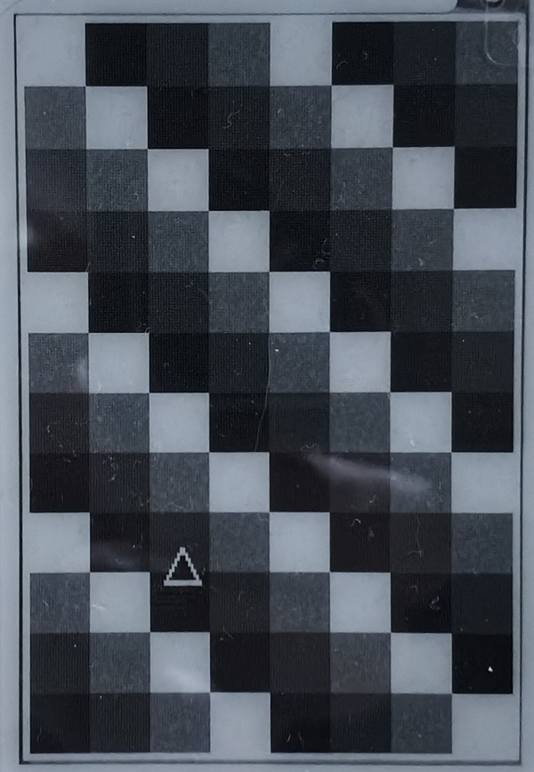
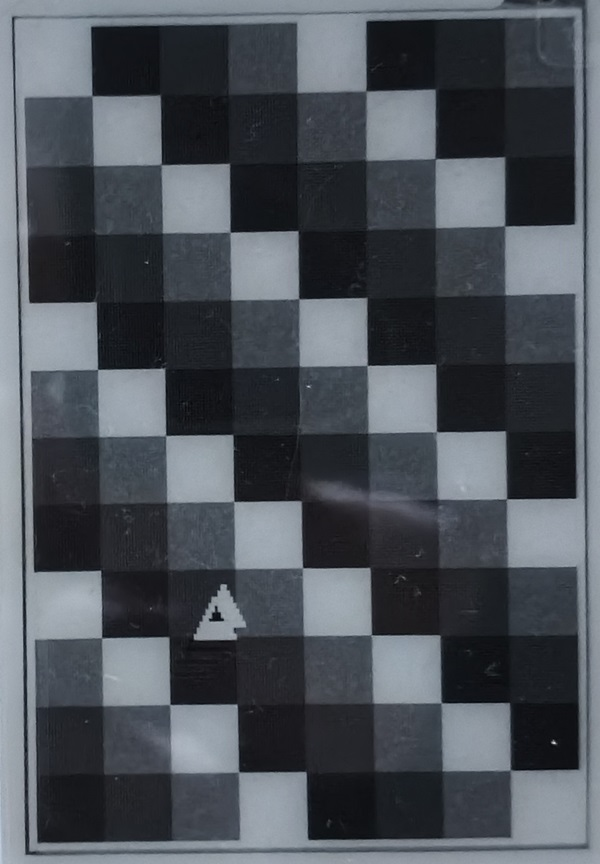

# epd4g — частичное обновление E-Ink в 4 градациях серого (Waveshare 2.7" V2, STM32)

*English summary: `epd4g/` is a small C library for the Waveshare 2.7" e-Paper HAT (V2, 264×176) that does **partial refresh in 4-gray mode** (vendor library only offers it in 1-bit mode) and a fast full refresh. Hardware-independent core, ready STM32 HAL port, host tests. Measured on STM32F411: partial ≈ 1.4 s, full ≈ 2.9 s.*

Документация Waveshare описывает partial refresh только для 1-битного режима. Библиотека `epd4g` делает его для **2 бит на пиксель (4 серых)**: перерисовываются только пиксели из маски, остальной экран не мигает. Заодно в 2 раза ускорено полное обновление.

| Анимация (треугольник движется по фону из 4 серых) | |
|---|---|
|  |  |

Репозиторий — это два слоя:

* **`epd4g/`** — сама библиотека. Самодостаточная, подключается как git-сабмодуль или копированием файлов в любой проект на STM32 (и не только, см. [порт](#порт-на-другую-платформу)).
* **корень репозитория** — эталонный проект STM32CubeMX (STM32F411CEU6) с демо-анимацией, на котором библиотека отлажена.

## Содержание

1. [Результаты](#результаты)
2. [Быстрый старт](#быстрый-старт)
3. [Подключение к своему проекту](#подключение-к-своему-проекту)
4. [Порт на другую платформу](#порт-на-другую-платформу)
5. [Справочник API](#справочник-api)
6. [Конфигурация](#конфигурация)
7. [Как это работает](#как-это-работает)
8. [Подбор параметров](#подбор-параметров)
9. [Диагностика](#диагностика)
10. [Тесты](#тесты)
11. [Демо-проект](#демо-проект)
12. [Ограничения](#ограничения)
13. [Миграция со старой версии](#миграция-со-старой-версии)
14. [Лицензия и благодарности](#лицензия-и-благодарности)

## Результаты

Измерено на железе: Waveshare 2.7" HAT V2 + STM32F411CEU6 (HSI 16 МГц, SPI1 8 МГц), STM32 HAL, сборка Debug. Лог: [`Docs/perf_log_epd4g.txt`](Docs/perf_log_epd4g.txt).

| Операция | Время | Волна панели |
|---|---|---|
| Частичное обновление (≈100 изменённых пикселей) | **1431 мс** | 53 кадра × 20 мс |
| Полное обновление, `EPD4G_FULL_FAST` | **2873 мс** | 136 кадров |
| Полное обновление, `EPD4G_FULL_DEEP` (штатная волна Waveshare) | ≈ 5,3 с + служебные | 262 кадра |

Разбивка частичного обновления (`EPD4G_PROFILE`): подготовка 2 мс, SPI 63 + 63 мс, проход 1 — 1013 мс (45 кадров = 900 мс + ≈110 мс служебных), проход 2 — 290 мс (8 кадров = 160 мс + ≈130 мс служебных).

Как к этому шли (одна и та же панель, один и тот же кадр):

| Версия | Частичное | Полное |
|---|---|---|
| стирание → рисование, `T_ROW3`=25 | 2048 мс | 6374 мс |
| чёрный не дожимался, `T_ROW3`=45; полное с `RP`=1 | 2448 мс | 4302 мс |
| **`epd4g`**: один проход стирания, питание не отключается, без аппаратного сброса, `RP`=0 | **1431 мс** | **2873 мс** |

Ресурсы библиотеки (Cortex-M4, `-Os`): код ≈ 2,8 КБ, RAM ≈ 1 КБ (таблицы) + 5,8 КБ (общая маска, отключается `EPD4G_INTERNAL_MASK=0`). Буфер кадра (11 616 байт) выделяет приложение.

## Быстрый старт

```c
#include <string.h>
#include "epd4g.h"
#include "epd4g_fb.h"

static uint8_t fb[EPD4G_FB_BYTES];      /* что должно быть на экране */
static uint8_t prev[EPD4G_FB_BYTES];    /* что на экране сейчас      */

void display_demo(void)
{
    if (epd4g_init() != EPD4G_OK) { /* панель не отвечает */ }

    /* рисуем в альбомной ориентации 264x176; уровни EPD4G_BLACK/DARK/LIGHT/WHITE */
    epd4g_fb_fill(fb, EPD4G_WHITE);
    for (int x = 20; x < 120; x++)
        epd4g_fb_set_rot(fb, EPD4G_ROT_90, x, 50, EPD4G_BLACK);

    epd4g_full(fb, EPD4G_FULL_DEEP);        /* первая картинка: самая чистая, ~5 с */
    memcpy(prev, fb, sizeof fb);

    for (;;) {
        /* меняем несколько пикселей ... */
        epd4g_fb_set_rot(fb, EPD4G_ROT_90, 200, 100, EPD4G_DARK);

        epd4g_partial_diff(prev, fb, NULL, NULL);   /* перерисует ровно изменившиеся пиксели, ~1,4 с */
        memcpy(prev, fb, sizeof fb);
    }
}
```

Каждые 5–10 обновлений полезно делать `epd4g_full(fb, EPD4G_FULL_FAST)`, чтобы сбросить накопившиеся следы (в демо — каждое 8-е). Если экран долго не обновляется — `epd4g_power_off()` или `epd4g_sleep()`.

## Подключение к своему проекту

### Требования

* Waveshare 2.7" e-Paper HAT (V2), 264×176. Другие размеры и ревизии **не поддерживаются** (другие контроллеры/LUT).
* C99, любой компилятор; оптимизация под GCC в Debug включается сама (`#pragma GCC optimize`).
* Порт для вашей платформы: 7 коротких функций. Готов порт для **STM32 HAL**.

### Вариант A: git-сабмодуль + CMake (рекомендуется)

```sh
git submodule add https://github.com/purrrock/eink_part_refresh external/eink_part_refresh
# необязательно: не качать демо-проект и HAL из этого репозитория
git -C external/eink_part_refresh sparse-checkout set epd4g
```

В `CMakeLists.txt` вашего проекта:

```cmake
add_subdirectory(external/eink_part_refresh/epd4g)
target_link_libraries(${CMAKE_PROJECT_NAME} PRIVATE epd4g)
```

`epd4g` — INTERFACE-библиотека: её исходники компилируются внутри вашей цели и получают её флаги, пути к HAL и `main.h`. Опции CMake: `EPD4G_PORT_STM32_HAL` (ON по умолчанию), `EPD4G_PROFILE` (OFF). Остальные настройки — определениями, например:

```cmake
target_compile_definitions(${CMAKE_PROJECT_NAME} PRIVATE EPD4G_FULL_SHAKE_RP=1 EPD4G_KEEP_POWER=0)
```

### Вариант B: скопировать файлы

Нужны (из `epd4g/`):

| Файл | Назначение |
|---|---|
| `include/epd4g.h`, `include/epd4g_config.h`, `include/epd4g_port.h` | публичный API, настройки, интерфейс порта |
| `src/epd4g.c` | ядро (инициализация, обновления) |
| `src/epd4g_fb.c`, `include/epd4g_fb.h` | вспомогательные функции: пиксели, поворот, маски, `epd4g_partial_diff`. Можно не брать, если маски строите сами |
| `port/stm32_hal/epd4g_port_stm32_hal.c` | порт под STM32 HAL (или ваш порт) |
| `NOTICE.md` | уведомление о коде Waveshare, **копируйте вместе с `epd4g.c`** |

Добавьте `include/` в пути поиска заголовков и файлы `.c` в сборку. Не-CMake системы (Makefile, Keil, IAR) работают так же.

### Настройка STM32CubeMX (для готового порта)

| Сигнал дисплея | Настройка | Метка в CubeMX |
|---|---|---|
| DIN | SPI MOSI | — |
| CLK | SPI SCK | — |
| CS | GPIO Output (программный CS) | `EINK_CS` |
| DC | GPIO Output | `EINK_DC` |
| RST | GPIO Output | `EINK_RST` |
| BUSY | GPIO Input | `EINK_BUSY` |

SPI: Master, 8 бит, MSB first, CPOL = Low, CPHA = 1 Edge, NSS = Software, скорость ≤ 10 МГц (в эталонном проекте 8 Мбит/с). MISO не нужен (Transmit Only). Другие имена меток, порты и SPI-хендл (по умолчанию `hspi1`) задаются макросами `EPD4G_RST_PORT/PIN`, `EPD4G_DC_…`, `EPD4G_CS_…`, `EPD4G_BUSY_…`, `EPD4G_SPI_HANDLE` — см. начало `port/stm32_hal/epd4g_port_stm32_hal.c`. Заголовок с HAL и метками (`main.h`) меняется через `EPD4G_HAL_HEADER`.

Подключение дисплея в эталонном проекте (STM32F411CEU6):

| Контакт дисплея | Пин STM32 | Настройка |
|---|---|---|
| VCC | 3V3 | питание |
| GND | GND | земля |
| DIN | PA7 | SPI1_MOSI |
| CLK | PA5 | SPI1_SCK |
| CS | PB7 | GPIO_Output, `EINK_CS` |
| DC | PB8 | GPIO_Output, `EINK_DC` |
| RST | PB9 | GPIO_Output, `EINK_RST` |
| BUSY | PB2 | GPIO_Input, `EINK_BUSY` |

## Порт на другую платформу

Реализуйте функции из `epd4g_port.h` (подключать `epd4g_port_stm32_hal.c` не нужно: `-DEPD4G_PORT_STM32_HAL=OFF` в CMake):

```c
void     epd4g_port_gpio_rst(int level);   /* вывод RST                                     */
void     epd4g_port_gpio_dc(int level);    /* вывод D/C: 0 = команда, 1 = данные            */
void     epd4g_port_gpio_cs(int level);    /* вывод CS (программный)                        */
int      epd4g_port_gpio_busy(void);       /* BUSY: 1 = занято, 0 = готово                  */
int      epd4g_port_spi_write(const uint8_t *data, size_t len);  /* блокирующая запись; 0 = успех */
void     epd4g_port_delay_ms(uint32_t ms); /* пауза; в RTOS здесь можно отдавать управление */
uint32_t epd4g_port_tick_ms(void);         /* монотонный счётчик миллисекунд (переполнение допустимо) */
```

SPI mode 0, MSB first. Строка кадра передаётся блоком по 22 байта, LUT — блоком в 153 байта. Хост-тесты используют именно этот интерфейс (симулятор панели вместо железа), так что новый порт можно отладить на ПК.

## Справочник API

Все функции блокирующие, не реентерабельные, не потокобезопасные. Возврат: `0` (`EPD4G_OK`) или код ошибки.

| Функция | Описание |
|---|---|
| `int epd4g_init(void)` | Аппаратный сброс и настройка регистров (последовательность штатной `Init_4GRAY`). Вызывать при старте, после `epd4g_sleep()` и после ошибки `EPD4G_ERR_TIMEOUT`. |
| `int epd4g_full(fb, mode)` | Полное обновление всего экрана (экран мигает). `EPD4G_FULL_FAST` — укороченная «встряска», ≈ 2,9 с. `EPD4G_FULL_DEEP` — штатная волна Waveshare, ≈ 5,3 с, лучше всего убирает следы. |
| `int epd4g_partial(fb, mask)` | Перерисовать только пиксели с битом 1 в `mask`; серые берутся из `fb`. ≈ 1,4 с. Нужно, чтобы на панели уже была известная картинка (после `epd4g_full`). |
| `int epd4g_partial_diff(prev, cur, roi, &changed)` | Сравнить `prev` (на экране) и `cur` (должно быть), перерисовать ровно отличающиеся пиксели. `roi` — ограничение области (NULL = весь экран), `changed` — число отличий (можно NULL). Если отличий нет, панель не трогается. |
| `int epd4g_partial_rect(fb, rect)` | Перерисовать прямоугольник (нативные координаты, включительно). |
| `int epd4g_power_off(void)` | Выключить аналоговую часть панели (нужно при `EPD4G_KEEP_POWER=1`, когда экран надолго простаивает). Следующее обновление включит её снова (≈ +0,3 с один раз). |
| `int epd4g_sleep(void)` | Выключить питание и перевести в deep sleep. Для пробуждения — `epd4g_init()`. |

`epd4g_partial_rect` и `epd4g_partial_diff` используют общий внутренний буфер маски (`EPD4G_INTERNAL_MASK=1`, по умолчанию) и находятся в `epd4g_fb.c`.

**Коды ошибок:** `EPD4G_ERR_TIMEOUT` (-1) — BUSY не опустился за `EPD4G_BUSY_TIMEOUT_MS` (после этого нужен `epd4g_init()`); `EPD4G_ERR_NOT_INIT` (-2); `EPD4G_ERR_PARAM` (-3) — NULL или пустой прямоугольник; `EPD4G_ERR_IO` (-4) — ошибка `epd4g_port_spi_write`.

### Формат буфера кадра

* Нативная ориентация панели — портрет **176 × 264**. Буфер: 2 бита на пиксель, 4 пикселя в байте, первый пиксель в старших битах, 44 байта на строку, **11 616 байт** (`EPD4G_FB_BYTES`). Это формат буфера Waveshare для 4 gray.
* Уровни: `EPD4G_BLACK`=0, `EPD4G_DARK`=1, `EPD4G_LIGHT`=2, `EPD4G_WHITE`=3. Какой из двух серых темнее на вашей панели — проверьте глазом (в демо на референсной панели уровни 0…3 дают четыре различимых серых, см. фото выше).
* Маска: 1 бит на пиксель, старший бит первым, 22 байта на строку, **5 808 байт** (`EPD4G_MASK_BYTES`).

### Помощники (`epd4g_fb.h`)

| Функция | Описание |
|---|---|
| `epd4g_fb_fill`, `epd4g_fb_set/get` | заливка, пиксель в нативных координатах |
| `epd4g_fb_set_rot`, `epd4g_fb_get_rot` | пиксель в логических координатах выбранной ориентации |
| `epd4g_logical_width/height(rot)`, `epd4g_map`, `epd4g_map_rect` | размеры и пересчёт координат / прямоугольников |
| `epd4g_fb_copy_rect` | восстановить прямоугольник из другого буфера (фон под спрайтом); копируются целые байтовые колонки |
| `epd4g_mask_clear/set/set_rect`, `epd4g_mask_from_diff` | построение маски обновления |

Ориентации: `EPD4G_ROT_0` — портрет 176×264; `EPD4G_ROT_90` — альбом 264×176 (в демо); `EPD4G_ROT_180`; `EPD4G_ROT_270` — альбом вверх ногами. Если изображение перевёрнуто, смените ориентацию.

## Конфигурация

Все макросы — в [`epd4g/include/epd4g_config.h`](epd4g/include/epd4g_config.h). Переопределяются через `-D…`, `target_compile_definitions()` или проектный заголовок (`-DEPD4G_USER_CONFIG="my_cfg.h"`).

| Макрос | По умолчанию | Смысл |
|---|---|---|
| `EPD4G_T_BLACK` | 45 | кадров VSH, дожимающих пиксель до чёрного. При штатных 25 чёрный недожат и оставляет светлые следы |
| `EPD4G_T_WHITE` | 40 | кадров VSL, дожимающих пиксель до белого из любого состояния |
| `EPD4G_T_DARK`, `EPD4G_T_LIGHT` | 8, 3 | кумулятивные кадры VSH для тёмно- и светло-серого (как в штатном LUT) |
| `EPD4G_FULL_SHAKE_RP` | 0 | повторов группы «встряски» в `FULL_FAST` минус 1: 3 = штатная волна (262 кадра), 1 = 178 кадров, 0 = 136 |
| `EPD4G_FULL_SHAKE_TP` | 20 | длительность фаз «встряски», кадров |
| `EPD4G_KEEP_POWER` | 1 | 1 — аналоговая часть остаётся включённой после обновления (быстрее, нужен `epd4g_power_off()` при простое); 0 — панель включается и выключается вокруг каждого прохода (≈ +330 мс на проход) |
| `EPD4G_BUSY_TIMEOUT_MS` | 10000 | таймаут ожидания BUSY |
| `EPD4G_BUSY_POLL_MS` | 1 | пауза между опросами BUSY (`epd4g_port_delay_ms`) |
| `EPD4G_BUSY_SETTLE_MS` | 2 | пауза после спада BUSY (в штатной библиотеке 20) |
| `EPD4G_INTERNAL_MASK` | 1 | собирать `epd4g_partial_diff/rect` с общим буфером маски 5808 байт |
| `EPD4G_PROFILE` | выкл. | запись времени по фазам, `epd4g_get_profile()` |
| `EPD4G_LOG(...)` | пусто | printf-подобный вывод сообщений библиотеки (инициализация, ошибки) |
| `EPD4G_NO_FORCE_O2` | выкл. | не форсировать `-O2` для файлов библиотеки в Debug-сборках |

## Как это работает

**Проблема.** Штатная 4-gray волна Waveshare (LUT) абсолютная: каждый пиксель сначала «встряхивается» (VSH/VSL по 20 кадров, 4 раза), затем сдвигается к нужному серому. Все 4 строки LUT заняты четырьмя серыми, поэтому нет кода «не трогать пиксель», а команда запуска `0x20` всегда обновляет всю панель: окно RAM лишь уменьшает передачу по SPI. Поэтому «частичное обновление» с штатным LUT мигало бы всем экраном.

**Решение.** Загружается собственный LUT (регистр `0x32`), в котором **строка 0 пустая («keep»)**: пиксели вне маски записываются в RAM как пара (0,0) и не получают напряжения. Обновление маскированных пикселей — две волны:

| Проход | Длительность | Что происходит |
|---|---|---|
| 1 | `max(T_WHITE, T_BLACK)` = 45 кадров | пиксели, которые должны стать чёрными, получают VSH `T_BLACK` кадров; все остальные маскированные — VSL `T_WHITE` кадров (насыщение к белому). Идут одновременно |
| 2 | `T_DARK` = 8 кадров | светло- и тёмно-серые пиксели получают VSH `T_LIGHT` / `T_DARK` кадров от белого |

Чёрный и белый — предельные состояния: их можно получить из любого старого цвета насыщающим импульсом, поэтому им не нужно предварительное стирание. Только два промежуточных серых должны стартовать от белого — это обеспечивает проход 1. Итого 53 кадра вместо 85 при схеме «стереть всё, затем нарисовать». Биты RAM каждого пикселя — те же, что пишет штатная `EPD_2IN7_V2_4GrayDisplay`, поэтому соответствие «серый → строка LUT» совпадает со штатным.

**Время.** Один кадр волны — 20 мс (частота кадров из штатного LUT), плюс постоянные потери. На референсной панели постоянная часть оказалась ≈ 110–130 мс на каждую команду `0x20`. Команда `0x22=0xC7` вдобавок включает и выключает аналоговую часть (≈ 330 мс); `EPD4G_KEEP_POWER` использует `0xC4` и не выключает её.

**Полное обновление.** `EPD4G_FULL_FAST` — штатный LUT, в котором группа «встряски» повторяется `RP+1` раз (по умолчанию 1). Каждое повторение сбалансировано по постоянной составляющей, а уровни серого задаются другими группами, поэтому градации не меняются. Аппаратный сброс не нужен (регистры настраивает `epd4g_init()`).

**Питание.** После обновления аналоговая часть остаётся включённой (`KEEP_POWER=1`). Это нормально при непрерывной работе, но для редко обновляемого дисплея вызывайте `epd4g_power_off()` (или `epd4g_sleep()`).

## Подбор параметров

Волны подобраны на одной панели при комнатной температуре. На другой партии, при другой температуре или на старой панели значения могут потребовать коррекции.

| Симптом | Что менять |
|---|---|
| Чёрное выглядит серым, светлые следы на месте чёрных пикселей | увеличить `EPD4G_T_BLACK` (штатное 25 недожимает; 45 работает на референсе) |
| Белые области серые / призраки старого чёрного | увеличить `EPD4G_T_WHITE` (должно быть не меньше времени, за которое чёрное уходит в белое) |
| Серые уровни слишком светлые / тёмные | `EPD4G_T_LIGHT`, `EPD4G_T_DARK` |
| Следы накапливаются за 8–10 частичных обновлений | чаще `epd4g_full`; `EPD4G_FULL_SHAKE_RP`=1; `EPD4G_FULL_DEEP` для самой чистой картинки |
| Частичное обновление слишком медленное | уменьшать `EPD4G_T_BLACK`/`T_WHITE` с контролем качества: время ≈ (`max(T_WHITE, T_BLACK)` + `T_DARK`) × 20 мс + ≈ 0,4 с |
| Изображение перевёрнуто / зеркально | выбрать другую `epd4g_rot_t` |

## Диагностика

Вся диагностика выключена по умолчанию и не занимает ни байта кода.

| Что | Как включить | Результат |
|---|---|---|
| Сообщения библиотеки | определить `EPD4G_LOG` (printf-подобный макрос), напр. в проектном заголовке: `#include <stdio.h>` и `#define EPD4G_LOG(...) printf(__VA_ARGS__)` | `[epd4g] BUSY timeout in …`, `[epd4g] init done` |
| Время по фазам | CMake: `-DEPD4G_PROFILE=ON` (или `-DEPD4G_PROFILE`) | `epd4g_get_profile()` → `setup, spi1, wait1, spi2, wait2` (мс); `wait*` — волна панели + питание, `spi*` — передача |
| Журнал демо в UART | CMake: `-DEINK_DIAG=ON` (по умолчанию ON в демо-проекте) | USART2, 115200 8N1: `[INIT]`, `[FRAME]`, `[UPDATE] … complete in N ms` |
| Время по фазам в журнале демо | `-DEINK_PROFILE=ON` (+ `EINK_DIAG`) | строка `[PROF] …` после каждого обновления |

Пример журнала демо (`EINK_DIAG=ON`, `EINK_PROFILE=ON`):

```
[FRAME] triangle (148,56)->(144,53)
[UPDATE] #2 rect X=109..132 Y=134..158, pixels in mask=104
[UPDATE] complete in 1431 ms
[PROF] setup=2 spi1=63 wait1=1013 spi2=63 wait2=290 ms
```

Типичные неисправности: `EPD4G_ERR_TIMEOUT` в `epd4g_init()` — нет питания, не подключён BUSY/RST, неверный пин; экран не реагирует, ошибок нет — проверьте режим SPI (mode 0) и пин DC; картинка инвертирована — уровни `EPD4G_BLACK`/`EPD4G_WHITE` перепутаны в вашем коде.

## Тесты

Хост-тесты (нужны только `gcc` и `make`, железо не нужно):

```sh
make -C epd4g/tests            # основной прогон
make -C epd4g/tests variants   # те же тесты с другими настройками (KEEP_POWER=0, RP=1/3, другие T_*, PROFILE)
```

Тесты подставляют вместо железа симулятор панели за интерфейсом порта и проверяют:

* **совместимость со штатной библиотекой Waveshare побайтно** (эталон `tests/golden.inc` снят с неё скриптом `tests/tools/gen_golden.c`): последовательность `epd4g_init()`, LUT штатной волны, биты обеих плоскостей RAM для 4-gray картинки, команда сна;
* **модель чернил**: к каждому пикселю применяются LUT и данные RAM, которые отправила библиотека (VSH темнит, VSL светлит, насыщение на краях). После каждого частичного обновления все пиксели должны показывать целевой серый, а немаскированные — не сдвинуться. Проверены все 16 переходов серых и маски 1–100 %;
* длительность проходов (53 кадра при настройках по умолчанию, 136 у быстрого полного, 262 у `DEEP`), команды питания (`0xC4`/`0xC7`/`0x83`), таймаут BUSY, ошибки SPI, параметры;
* помощники: поворот (биекция для всех ориентаций), маски, копирование прямоугольников.

Чувствительность проверена мутациями (испорченный регистр инициализации, перепутанные строки LUT, полярность битов и т.д. — каждая ловится тестом).

**Что тесты не доказывают:** модель чернил идеальная, реальное поведение панели (глубина чёрного, следы) проверяется только на железе; соответствие пары RAM → строка LUT взято как допущение модели. `epd4g_sleep()`/`epd4g_power_off()` сверены со штатными командами, но на железе не запускались.

Обновить эталон: `make -C epd4g/tests golden WS=<путь к e-Paper>/STM32/STM32-F103ZET6/User/e-Paper`.

## Демо-проект

Корень репозитория — проект STM32CubeMX для STM32F411CEU6 (HSI 16 МГц, без PLL), собирается в VS Code с расширением STM32Cube (CMake, пресеты `Debug` / `Release`). Демо рисует фон из квадратов 22×22 px четырёх серых и двигает по нему треугольник; каждое 8-е обновление — полное.

```sh
cmake --preset Debug
cmake --build build/Debug
```

Опции CMake демо:

| Опция | По умолчанию | Смысл |
|---|---|---|
| `EINK_DIAG` | ON | журнал в USART2 (printf). OFF — без `printf`, прошивка ≈ 9,5 КБ |
| `EINK_PROFILE` | OFF | печать времени по фазам, включает `EPD4G_PROFILE` |

Параметры демо (`-D…` в `CMakeLists.txt`): `EINK_ROT` (ориентация), `EINK_FULL_REFRESH_EVERY` (период полного обновления, 0 — никогда), `EINK_STEP_X`, `EINK_STEP_Y`.

Файлы: `Core/Src/eink_demo.c` — демо на API библиотеки; `Core/Src/main.c` — стандартный код CubeMX, пользовательские вставки в `USER CODE`; `eink_part_refresh.ioc` — конфигурация CubeMX. При перегенерации кода в CubeMX метки пинов должны остаться `EINK_CS`, `EINK_DC`, `EINK_RST`, `EINK_BUSY`.

## Структура репозитория

```
epd4g/                      библиотека (то, что подключают как сабмодуль)
  include/                  epd4g.h, epd4g_fb.h, epd4g_port.h, epd4g_config.h
  src/                      epd4g.c (ядро), epd4g_fb.c (помощники)
  port/stm32_hal/           порт под STM32 HAL
  tests/                    хост-тесты, эталон Waveshare, генератор эталона
  CMakeLists.txt            INTERFACE-библиотека epd4g
  NOTICE.md                 уведомление о коде Waveshare
Core/, Drivers/, cmake/     эталонный проект STM32CubeMX (STM32F411CEU6)
Docs/                       фото результата, лог измерений
```

## Ограничения

* Только Waveshare 2.7" e-Paper HAT **V2** (264×176) и режим 4 gray. Проверено на одной панели и одном МК (STM32F411CEU6, STM32 HAL).
* Частичное обновление ≈ 1,4 с: из них ≈ 1,06 с — сама волна панели (53 кадра по 20 мс), её без потери качества не сократить; остальное (≈ 0,37 с) — служебные потери панели и передача по SPI, их можно ещё немного уменьшить (см. `TODO.md`).
* Предполагается, что `prev` в точности соответствует тому, что на панели. Если оно разошлось (сбой, питание), сделайте `epd4g_full`.
* Остаточные следы накапливаются; периодически нужно полное обновление (в демо каждое 8-е). Влияние частых обновлений на срок службы панели не исследовалось.
* Температурной компенсации нет: волны фиксированные.
* Функции блокирующие. Для RTOS вызывайте из одной задачи; `epd4g_port_delay_ms` в BUSY-цикле можно сделать точкой переключения.
* `epd4g_sleep()` и `epd4g_power_off()` на железе не проверены.

## Лицензия и благодарности

* Таблица LUT и последовательность инициализации взяты из библиотеки [Waveshare e-Paper](https://github.com/waveshareteam/e-Paper) (разрешительная MIT-подобная лицензия, © Waveshare team). Текст уведомления — в [`epd4g/NOTICE.md`](epd4g/NOTICE.md); при копировании `epd4g.c` в другой проект сохраняйте его.
* Лицензия самого проекта MIT.
* Код STM32 HAL и CMSIS в `Drivers/` принадлежит STMicroelectronics и распространяется на условиях его лицензий.
